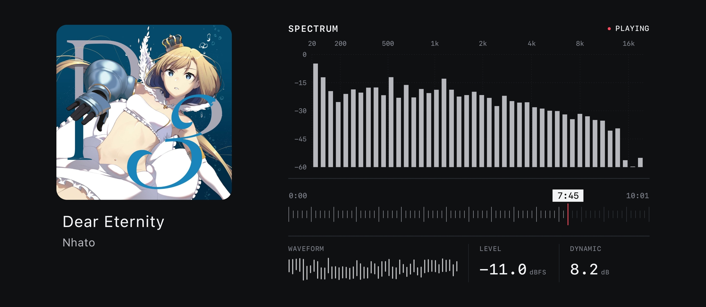

# VENAS Fold Spectrum

本软件主要为 Android 系统折叠屏手机设计，实现后台音频的可视化（直板机手机也可以正常使用）。启动软件后半折手机置于桌面上，会在音乐播放时展示当前音乐的封面、信息、实时频谱、播放进度和实时波形（无音乐播放时则显示极简时钟）。



---

## 特性说明

- 初始页右上角的旋转按钮可手动横屏：非折叠模式下直接进入可视化；折叠模式下仍需满足原有半折判定。手动进入后可按返回键退出；非折叠模式实际横放过手机后，竖起仍自动返回初始页。

- 软件通过检测转轴角度实现半折检测，半折检测的角度范围为 **10°～150°**。

- 对于非折叠屏手机，可以通过打开设置中的“非折叠模式”改变侦测逻辑，旋转手机后自动进入可视化界面（建议自行准备支架以提升展示效果）。

- 在可视化界面可通过单击封面进行暂停/播放，在封面上左右滑动可切换歌曲。

- 在可视化界面拖动播放进度条可以调整播放进度。

## 设置说明

在初始页可展开设置；在可视化界面单击任意位置会在界面右上角显示设置图标，单击后进入设置。

- 旋转 180°：可视化界面下会禁用系统自动旋转，如果你的使用场景下显示的内容是倒过来的，可以通过开关该选项反转显示方向。

- 非折叠模式：为非折叠屏手机提供（折叠屏手机也可以开，开启后不需要半折屏幕即可显示可视化），旋转横放手机自动进入可视化模式，竖起手机返回初始页。

- 屏幕常亮：开启后可视化显示时屏幕常亮，禁用系统自动息屏。

- 界面亮度：关闭时跟随系统，开启后可指定亮度，禁用系统自动亮度调整。

- 音量调整：可视化界面单击封面和进度条以外区域，右上角出现音量与设置按钮；点击音量按钮，在其左侧展开滑条，调整系统媒体音量。

- 防烧屏模式：开启时在可视化模式下，闲置一分钟后通过棋盘遮罩关闭一部分像素，并每五分钟切换一次（屏幕亮度会变低）。点击屏幕时恢复到正常显示状态并重置计时。该模式旨在避免 OLED 屏幕的烧屏情况，思路来源于“Linzin 桌面時鐘”。

## 项目构建

需要 JDK 17或21、Android SDK 36。`local.properties` 指向自己的SDK目录。

```sh
./gradlew :app:assembleDebug :app:testDebugUnitTest :app:lintDebug
```

开发调试使用 `debug`。发给别人测试推荐 `preview`：开启 R8 代码优化与资源裁剪，使用本机调试签名自动签名，功能和字体保持一致，无需自己创建签名密钥。

```sh
./gradlew :app:assemblePreview
```

输出：`app/build/outputs/apk/preview/app-preview.apk`。Android Studio 中打开 **Build Variants**，将 `app` 切换为 `preview`，然后使用 **Build → Generate App Bundles or APKs → Generate APKs**（旧版为 **Build APK(s)**）。需要断点调试时切回 `debug`。

`preview` 和本机 `debug` 包名、签名相同，可互相覆盖安装并保留设置。它是压缩测试版；正式发布选择 `release`，通过 **Generate Signed App Bundle or APK** 使用自己的正式签名。普通 `assembleRelease` 输出未签名APK，不能直接安装。

```sh
adb install -r app/build/outputs/apk/debug/app-debug.apk
adb shell am start -n com.venas.foldspectrum/.MainActivity
adb logcat -s VenasFold VenasMedia VenasAudio AndroidRuntime
```

初始页通过圆角矩形按钮展开／收起旋转180°、非折叠模式、屏幕常亮、界面亮度、防烧屏模式；只有右侧开关可切换，文字和空白不触发。亮度关闭时跟随系统，开启后显示手动滑杆，仅作用于本应用窗口。全部设置保存。可视化中点击封面和进度区外，右上角设置图标淡入，3秒未点击淡出；再次点击续期。图标右边缘对齐播放状态文字，点击后打开同一组设置。

实际横屏窗口宽高比1.20～1.60自动使用阔屏布局，覆盖1.41:1；其他比例继续原布局。阔屏缩小等距留白、增大封面，重新分配三栏宽度。

底部为无边框 WAVEFORM、LEVEL、DYNAMIC 三栏信息条。连续拖动以屏幕当前红线位置为起点，待播放器确认时保留最新目标；未确认会明确提示并恢复实际进度。网易云与Poweramp已完成本机蓝牙、进度手势回归；其他设备与输出组合仍需实测。

暂停时封面以中心为锚点缩到75%，恢复播放放大；当前封面按手势做圆角透视翻页，新封面到达后淡入。播放状态封面顶部固定，与SPECTRUM对齐，曲名换行只使艺人下移。占位封面资源：[album_placeholder.xml](app/src/main/res/drawable/album_placeholder.xml)。

## 权限与隐私

应用首次启动时需要开启两项权限：

- 通知权限：读取当前播放器的封面、曲名、艺人、播放状态和进度，并进行播放／暂停、切歌及进度控制。软件不会主动发送通知。

- 音频权限（系统可能显示为“麦克风”或“录音”）：用于获取系统正在播放音频的实时波形和频谱。应用不会打开麦克风或保存音频。

网络权限访问不需要授权，仅用于读取播放器在媒体元数据中提供的HTTPS封面地址，当访问失败时显示默认封面。软件不会上传数据。

## 兼容性说明

- 软件的折叠模式支持主流的具有转轴传感器的大折叠手机，包括荣耀、OPPO、VIVO、三星、小米、Google Pixel。

- 非折叠屏手机可以通过非折叠模式进行使用。

- 系统版本要求：Android 12 及以上。

## 软件参考

折叠屏厂商状态映射和防烧屏优化参考了UP主Linzin阿哲开发的 [Linzin 桌面時鐘](https://github.com/linzin86/LinzinDeskClock)。
